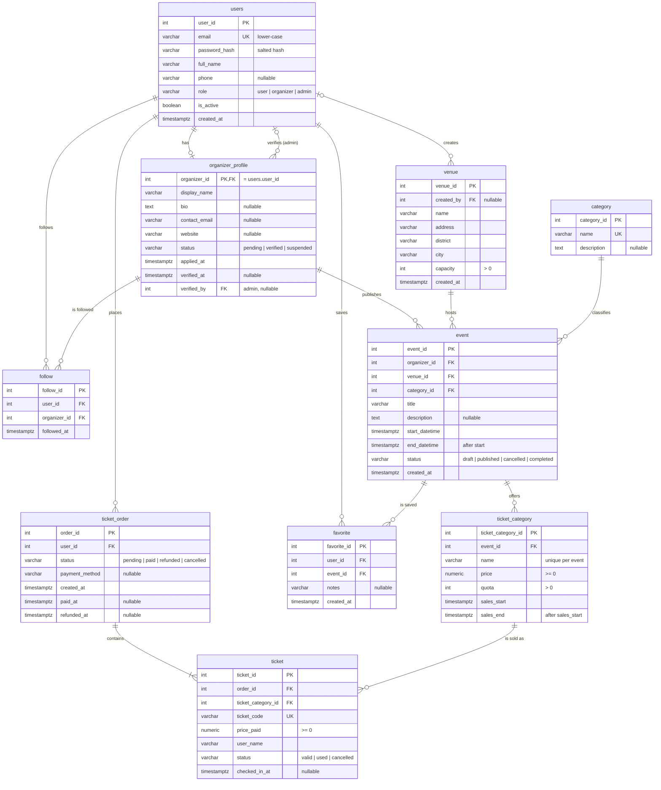

# ER diagram and data model

The complete data model: 10 tables, 2 per team member.

| #   | Table               | Owner                 |
| --- | ------------------- | --------------------- |
| 1   | `users`             | Bahadır Karadağ       |
| 2   | `organizer_profile` | Ömer Faruk Demir      |
| 3   | `category`          | Mehmet Furkan Unutan  |
| 4   | `venue`             | Nagehan Raziye Dinç   |
| 5   | `event`             | Bahadır Karadağ       |
| 6   | `ticket_category`   | Nagehan Raziye Dinç   |
| 7   | `ticket_order`      | Muhammed Nusret Yavuz |
| 8   | `ticket`            | Muhammed Nusret Yavuz |
| 9   | `follow`            | Ömer Faruk Demir      |
| 10  | `favorite`          | Mehmet Furkan Unutan  |

## Diagram

Notation: crow's foot. `||` exactly one, `|o` zero or one, `o{` zero or many, `|{` one or many.

## Relationships

| Entity A          | Relationship | Entity B          | Cardinality | Participation                                                                    | FK and ON DELETE                                              |
| ----------------- | ------------ | ----------------- | ----------- | -------------------------------------------------------------------------------- | ------------------------------------------------------------- |
| users             | has          | organizer_profile | 1 : 0..1    | Optional for users, mandatory for organizer_profile                              | `organizer_profile.organizer_id` (PK and FK) → users, CASCADE |
| users (admin)     | verifies     | organizer_profile | 0..1 : N    | Optional on both sides (unset while pending)                                     | `organizer_profile.verified_by` → users, SET NULL             |
| users             | creates      | venue             | 0..1 : N    | Optional; the creator may later be deleted                                       | `venue.created_by` → users, SET NULL                          |
| organizer_profile | publishes    | event             | 1 : N       | Mandatory for event                                                              | `event.organizer_id` → organizer_profile, RESTRICT            |
| venue             | hosts        | event             | 1 : N       | Mandatory for event                                                              | `event.venue_id` → venue, RESTRICT                            |
| category          | classifies   | event             | 1 : N       | Mandatory for event                                                              | `event.category_id` → category, RESTRICT                      |
| event             | offers       | ticket_category   | 1 : N       | Mandatory for ticket_category; a draft event may have none yet                   | `ticket_category.event_id` → event, CASCADE                   |
| users             | places       | ticket_order      | 1 : N       | Mandatory for ticket_order                                                       | `ticket_order.user_id` → users, RESTRICT                      |
| ticket_order      | contains     | ticket            | 1 : 1..N    | Both mandatory: an order and its tickets are created in one transaction (NFR-06) | `ticket.order_id` → ticket_order, CASCADE                     |
| ticket_category   | is sold as   | ticket            | 1 : N       | Mandatory for ticket                                                             | `ticket.ticket_category_id` → ticket_category, RESTRICT       |
| users             | follows      | organizer_profile | M : N       | Optional on both sides                                                           | resolved by `follow` (CASCADE on both FKs)                    |
| users             | saves        | event             | M : N       | Optional on both sides                                                           | resolved by `favorite` (CASCADE on both FKs)                  |

How the ON DELETE rules carry out the Milestone 1 CRUD notes:

- **Event with sold tickets cannot be deleted.** Deleting an event cascades to its
  ticket categories, but `ticket → ticket_category` is RESTRICT, so the delete fails
  while any ticket exists. Such events are cancelled (`status = 'cancelled'`) instead.
- **Category / venue / organizer in use cannot be deleted.** `event` FKs are RESTRICT.
- **Users with orders are deactivated, not deleted.** `ticket_order.user_id` is RESTRICT;
  `is_active = FALSE` is used instead. A user without orders can be deleted, and their
  follows, favorites and organizer profile go with them (CASCADE).
- **A pending order is deleted together with its tickets.** `ticket.order_id` is CASCADE.

## Tables

Types are PostgreSQL. Every `*_id` primary key is `INT GENERATED ALWAYS AS IDENTITY`
unless stated otherwise.

### 1. users — Bahadır Karadağ

| Column        | Type         | Key | Constraints                                               |
| ------------- | ------------ | --- | --------------------------------------------------------- |
| user_id       | INT          | PK  | identity                                                  |
| email         | VARCHAR(255) | UK  | NOT NULL, `email = lower(email)`, format check            |
| password_hash | VARCHAR(255) |     | NOT NULL (salted hash, NFR-02)                            |
| full_name     | VARCHAR(100) |     | NOT NULL, not blank                                       |
| phone         | VARCHAR(20)  |     | NULL                                                      |
| role          | VARCHAR(20)  |     | NOT NULL, DEFAULT 'user', IN ('user','organizer','admin') |
| is_active     | BOOLEAN      |     | NOT NULL, DEFAULT TRUE                                    |
| created_at    | TIMESTAMPTZ  |     | NOT NULL, DEFAULT now()                                   |

### 2. organizer_profile — Ömer Faruk Demir

| Column        | Type         | Key                     | Constraints                                                        |
| ------------- | ------------ | ----------------------- | ------------------------------------------------------------------ |
| organizer_id  | INT          | PK, FK → users(user_id) | ON DELETE CASCADE (not identity: same value as the user)           |
| display_name  | VARCHAR(100) |                         | NOT NULL, not blank                                                |
| bio           | TEXT         |                         | NULL                                                               |
| contact_email | VARCHAR(255) |                         | NULL                                                               |
| website       | VARCHAR(255) |                         | NULL                                                               |
| status        | VARCHAR(20)  |                         | NOT NULL, DEFAULT 'pending', IN ('pending','verified','suspended') |
| applied_at    | TIMESTAMPTZ  |                         | NOT NULL, DEFAULT now()                                            |
| verified_at   | TIMESTAMPTZ  |                         | NULL                                                               |
| verified_by   | INT          | FK → users(user_id)     | NULL, ON DELETE SET NULL                                           |

Rules: verifying sets `status = 'verified'`, `verified_at`, `verified_by` **and**
`users.role = 'organizer'` in one transaction (FR-07). CHECK `(status = 'pending') OR verified_at IS NOT NULL`.

### 3. category — Mehmet Furkan Unutan

| Column      | Type        | Key | Constraints         |
| ----------- | ----------- | --- | ------------------- |
| category_id | INT         | PK  | identity            |
| name        | VARCHAR(50) | UK  | NOT NULL, not blank |
| description | TEXT        |     | NULL                |

### 4. venue — Nagehan Raziye Dinç

| Column     | Type         | Key                 | Constraints              |
| ---------- | ------------ | ------------------- | ------------------------ |
| venue_id   | INT          | PK                  | identity                 |
| created_by | INT          | FK → users(user_id) | NULL, ON DELETE SET NULL |
| name       | VARCHAR(150) |                     | NOT NULL                 |
| address    | VARCHAR(255) |                     | NOT NULL                 |
| district   | VARCHAR(50)  |                     | NOT NULL                 |
| city       | VARCHAR(50)  |                     | NOT NULL                 |
| capacity   | INT          |                     | NOT NULL, CHECK > 0      |
| created_at | TIMESTAMPTZ  |                     | NOT NULL, DEFAULT now()  |

Rules: UNIQUE (name, city).

### 5. event — Bahadır Karadağ

| Column         | Type         | Key                                  | Constraints                                                                 |
| -------------- | ------------ | ------------------------------------ | --------------------------------------------------------------------------- |
| event_id       | INT          | PK                                   | identity                                                                    |
| organizer_id   | INT          | FK → organizer_profile(organizer_id) | NOT NULL, ON DELETE RESTRICT                                                |
| venue_id       | INT          | FK → venue(venue_id)                 | NOT NULL, ON DELETE RESTRICT                                                |
| category_id    | INT          | FK → category(category_id)           | NOT NULL, ON DELETE RESTRICT                                                |
| title          | VARCHAR(150) |                                      | NOT NULL, not blank                                                         |
| description    | TEXT         |                                      | NULL                                                                        |
| start_datetime | TIMESTAMPTZ  |                                      | NOT NULL                                                                    |
| end_datetime   | TIMESTAMPTZ  |                                      | NOT NULL, CHECK > start_datetime                                            |
| status         | VARCHAR(20)  |                                      | NOT NULL, DEFAULT 'draft', IN ('draft','published','cancelled','completed') |
| created_at     | TIMESTAMPTZ  |                                      | NOT NULL, DEFAULT now()                                                     |

### 6. ticket_category — Nagehan Raziye Dinç

| Column             | Type          | Key                  | Constraints                            |
| ------------------ | ------------- | -------------------- | -------------------------------------- |
| ticket_category_id | INT           | PK                   | identity                               |
| event_id           | INT           | FK → event(event_id) | NOT NULL, ON DELETE CASCADE            |
| name               | VARCHAR(50)   |                      | NOT NULL (e.g. Standard, Student, VIP) |
| price              | NUMERIC(10,2) |                      | NOT NULL, CHECK >= 0                   |
| quota              | INT           |                      | NOT NULL, CHECK > 0                    |
| sales_start        | TIMESTAMPTZ   |                      | NOT NULL                               |
| sales_end          | TIMESTAMPTZ   |                      | NOT NULL, CHECK > sales_start          |

Rules: UNIQUE (event_id, name). **Remaining tickets are derived, not stored:**
`quota − COUNT(ticket WHERE status <> 'cancelled')`. Lowering `quota` below the sold
count is rejected by the application (M1 CRUD note).

### 7. ticket_order — Muhammed Nusret Yavuz

| Column         | Type        | Key                 | Constraints                                                               |
| -------------- | ----------- | ------------------- | ------------------------------------------------------------------------- |
| order_id       | INT         | PK                  | identity                                                                  |
| user_id        | INT         | FK → users(user_id) | NOT NULL, ON DELETE RESTRICT                                              |
| status         | VARCHAR(20) |                     | NOT NULL, DEFAULT 'pending', IN ('pending','paid','refunded','cancelled') |
| payment_method | VARCHAR(20) |                     | NULL, IN ('credit_card','debit_card','wallet')                            |
| created_at     | TIMESTAMPTZ |                     | NOT NULL, DEFAULT now()                                                   |
| paid_at        | TIMESTAMPTZ |                     | NULL                                                                      |
| refunded_at    | TIMESTAMPTZ |                     | NULL                                                                      |

Rules: CHECK `status <> 'paid' OR paid_at IS NOT NULL`;
CHECK `status <> 'refunded' OR refunded_at IS NOT NULL`.

### 8. ticket — Muhammed Nusret Yavuz

| Column             | Type          | Key                                      | Constraints                                                |
| ------------------ | ------------- | ---------------------------------------- | ---------------------------------------------------------- |
| ticket_id          | INT           | PK                                       | identity                                                   |
| order_id           | INT           | FK → ticket_order(order_id)              | NOT NULL, ON DELETE CASCADE                                |
| ticket_category_id | INT           | FK → ticket_category(ticket_category_id) | NOT NULL, ON DELETE RESTRICT                               |
| ticket_code        | VARCHAR(16)   | UK                                       | NOT NULL (random, e.g. `secrets.token_hex(8)`)             |
| price_paid         | NUMERIC(10,2) |                                          | NOT NULL, CHECK >= 0 (price at purchase time)              |
| user_name          | VARCHAR(100)  |                                          | NOT NULL                                                   |
| status             | VARCHAR(20)   |                                          | NOT NULL, DEFAULT 'valid', IN ('valid','used','cancelled') |
| checked_in_at      | TIMESTAMPTZ   |                                          | NULL                                                       |

Rules: CHECK `status <> 'used' OR checked_in_at IS NOT NULL`. Purchase (FR-04) locks the ticket_category row with
`SELECT ... FOR UPDATE` before counting, so two buyers cannot oversell the quota.

### 9. follow — Ömer Faruk Demir

| Column       | Type        | Key                                  | Constraints                 |
| ------------ | ----------- | ------------------------------------ | --------------------------- |
| follow_id    | INT         | PK                                   | identity                    |
| user_id      | INT         | FK → users(user_id)                  | NOT NULL, ON DELETE CASCADE |
| organizer_id | INT         | FK → organizer_profile(organizer_id) | NOT NULL, ON DELETE CASCADE |
| followed_at  | TIMESTAMPTZ |                                      | NOT NULL, DEFAULT now()     |

Rules: UNIQUE (user_id, organizer_id); CHECK `user_id <> organizer_id` (no self-follow).

### 10. favorite — Mehmet Furkan Unutan

| Column      | Type         | Key                  | Constraints                    |
| ----------- | ------------ | -------------------- | ------------------------------ |
| favorite_id | INT          | PK                   | identity                       |
| user_id     | INT          | FK → users(user_id)  | NOT NULL, ON DELETE CASCADE    |
| event_id    | INT          | FK → event(event_id) | NOT NULL, ON DELETE CASCADE    |
| notes       | VARCHAR(500) |                      | NULL (personal note, editable) |
| created_at  | TIMESTAMPTZ  |                      | NOT NULL, DEFAULT now()        |

Rules: UNIQUE (user_id, event_id).

## Changes from Milestone 1 (for Milestone 2 §10.2)

- `User` is named `users`: `USER` is a reserved word in PostgreSQL. All table names are snake_case.
- Primary keys are `INT GENERATED ALWAYS AS IDENTITY`; timestamps are `TIMESTAMPTZ`; money is `NUMERIC(10,2)`.
- `organizer_profile` had only its key in M1. It now stores display name, bio, contact
  details and the verification workflow (`status`, `applied_at`, `verified_at`, `verified_by`).
- Remaining tickets are not stored in `ticket_category`; they are computed from `quota`
  and sold tickets, so the value can never go out of sync.
- Added `created_at` / `followed_at` timestamps to `venue`, `follow` and `favorite`.
- `role`, every `status` column and `payment_method` are limited with `CHECK` constraints;
  junction tables have UNIQUE pairs so the same follow / favorite cannot be stored twice.
- E-mails are stored lower-case (`CHECK (email = lower(email))`) so uniqueness ignores case.
